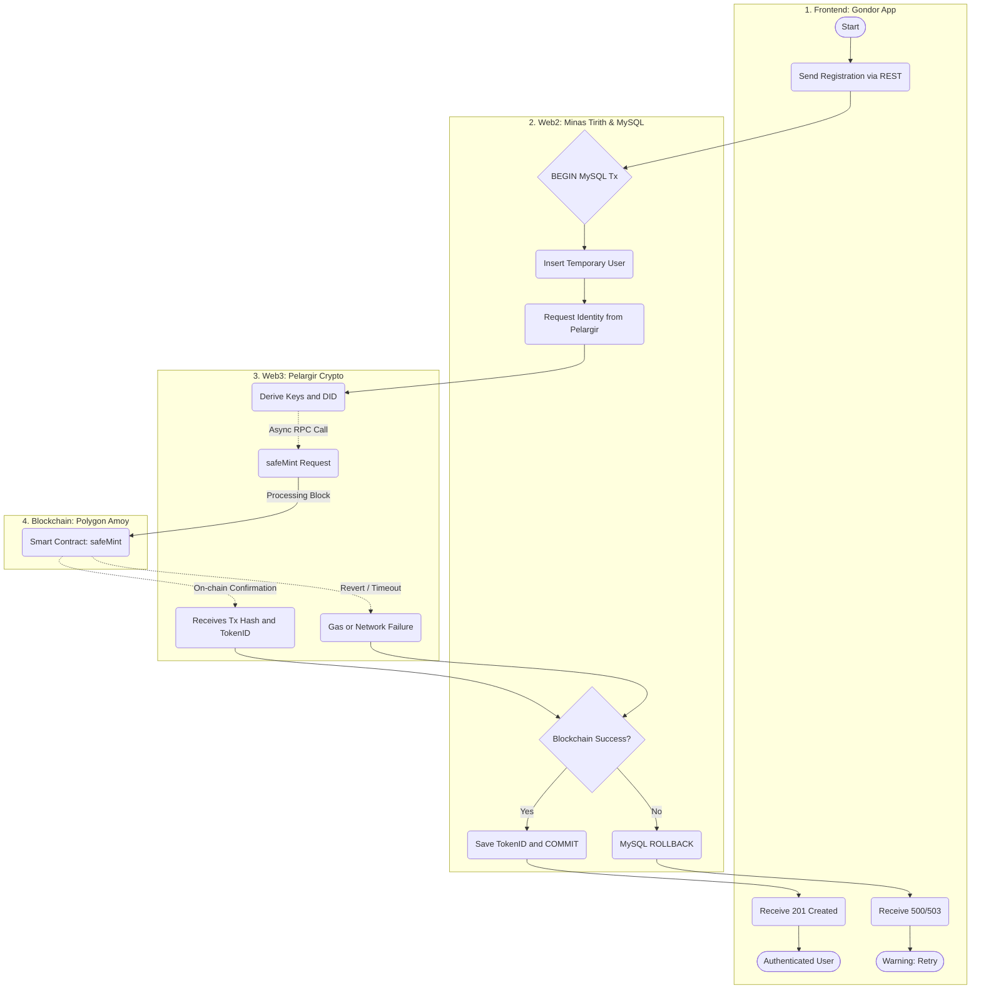
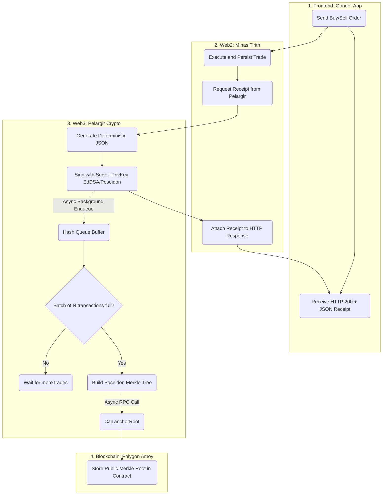
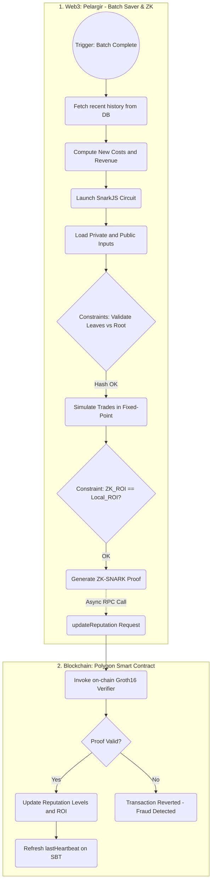
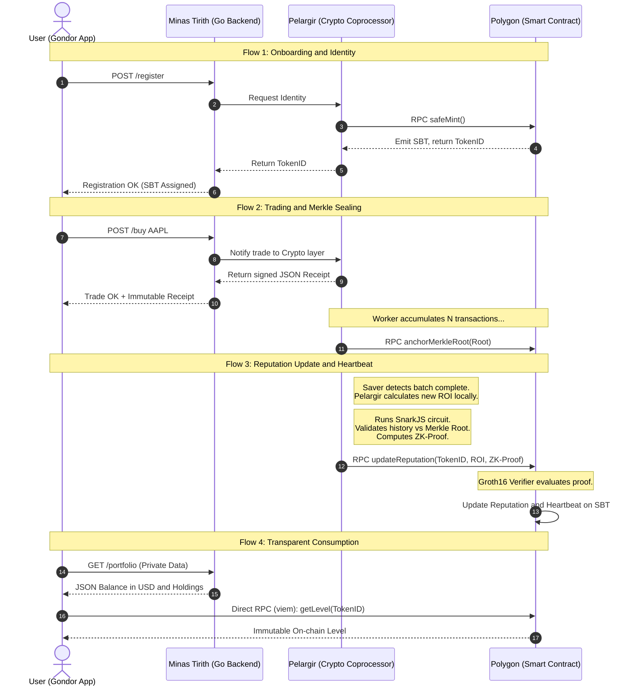

# Blockchain Interaction Flow

End-to-end lifecycle of an investor in the Gondor Ecosystem across four sequential blockchain interaction flows.

---

## System Actors

| Actor | Role |
|---|---|
| **Gondor App (Frontend)** | Mobile app operating on two parallel channels: REST calls to backend for trading, RPC calls to Polygon for reputation reading |
| **Minas Tirith (Web2 Backend)** | Financial engine in Go — authentication, MySQL, portfolios, Redis-cached price APIs |
| **Pelargir (Web3 Coprocessor)** | Go module for intensive cryptography — signs receipts, builds Merkle trees, generates ZK-SNARK proofs, manages blockchain write transactions |
| **GondorSovereignIdentity (Smart Contract)** | Polygon contract — stores SBTs, manages Merkle root registry, acts as mathematical judge verifying Groth16 proofs before updating investor reputation |

---

## Flow 1: Onboarding and Identity (SBT Creation)

The goal is to assign a decentralized identity without exposing the user to Web3 friction. The flow requires atomic transactions to ensure the Web2 registration and blockchain identity are always in sync.



---

## Flow 2: Trading and Data Sealing (Merkle Batching)

The user begins investing. Trade data must be sealed at execution time to prevent any retroactive manipulation by the platform. Asynchronous background processes are used to avoid blocking the user experience during batch assembly.



---

## Flow 3: Reputation Update and Heartbeat (ZK Proofs)

This flow updates and certifies the investor's true ROI level on-chain while preserving privacy. As a secondary effect, it refreshes the on-chain Heartbeat to prevent loss concealment through inactivity. Triggered automatically by Pelargir when a transaction batch is complete (either naturally or forced by the HeartbeatCron).



---

## Flow 4: Transparent Consumption (Truth on the Frontend)

The user opens the app to view their public reputation. To guarantee Minas Tirith cannot censor or misrepresent on-chain data, the device splits requests across two independent channels.

```mermaid
flowchart TD
    subgraph App [Frontend: Gondor App]
        UserOpen(User Opens Dashboard) --> DoubleRequest[Generate Parallel Requests]

        DoubleRequest --> AskWeb2(REST Call to Gondor API)
        DoubleRequest --> AskWeb3(RPC Call to Polygon Node)

        ShowWeb2(Render Private Balance in USD and Holdings)
        ShowWeb3(Render Immutable On-chain Reputation and Level)
    end

    subgraph MT [Web2: Minas Tirith]
        AskWeb2 --> QueryMySQL(Read MySQL / Redis Backend)
        QueryMySQL --> ShowWeb2
    end

    subgraph Polygon [Blockchain: Polygon Amoy]
        AskWeb3 -.->|viem getLevel() direct contract call| ReadContract(Free View State Read)
        ReadContract -.->|Returns Uint and Heartbeat Date| ShowWeb3
    end
```

---

## Complete Sequential Lifecycle

Full end-to-end interaction sequence from registration to reputation display.


