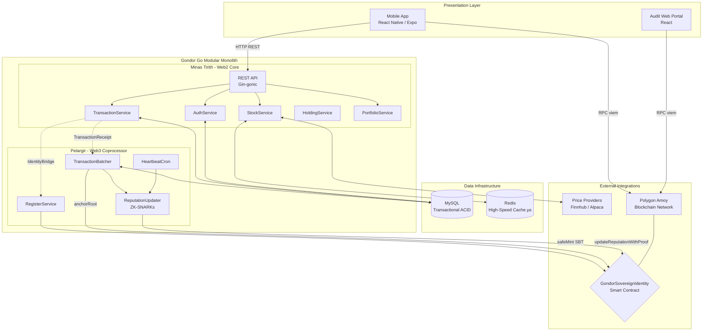

# Global Architecture Diagram

Full system component interaction diagram for the Gondor Ecosystem.

## Component Responsibility Summary

| Component | Module | Primary Responsibility |
|---|---|---|
| `REST API` | Minas Tirith | HTTP routing, JWT middleware, request/response mapping |
| `TransactionService` | Minas Tirith | Trade execution, ROI calculation, holding updates |
| `StockService` | Minas Tirith | Real-time stock price serving (Redis-first) |
| `AuthService` | Minas Tirith | User registration, login, JWT issuance |
| `HoldingService` | Minas Tirith | Aggregate position management per user/symbol |
| `PortfolioService` | Minas Tirith | Consolidated portfolio valuation |
| `RegisterService` | Pelargir | Wallet generation + SBT minting (IdentityBridge implementor) |
| `TransactionBatcher` | Pelargir | Signed receipt buffering, Merkle tree construction, `anchorRoot` |
| `ReputationUpdater` | Pelargir | ZK proof generation (SnarkJS CLI), `updateReputationWithProof` |
| `HeartbeatCron` | Pelargir | Forces batch completion with dummy transactions for inactive users |
| `MySQL` | Infrastructure | Persistent storage for users, transactions, holdings, batches |
| `Redis` | Infrastructure | In-memory cache for stock prices (µs read latency) |
| `GondorSovereignIdentity` | Blockchain | ERC-721 SBT, Merkle root registry, ZK proof verifier interface |
