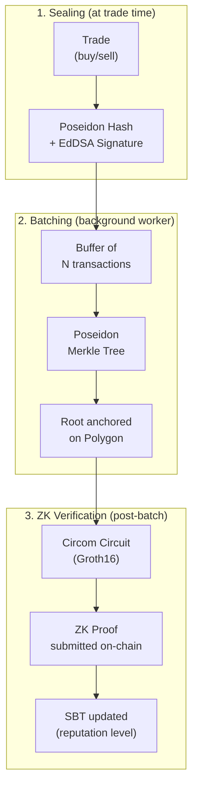
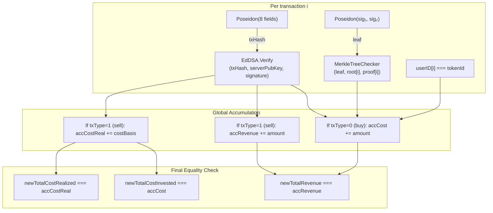
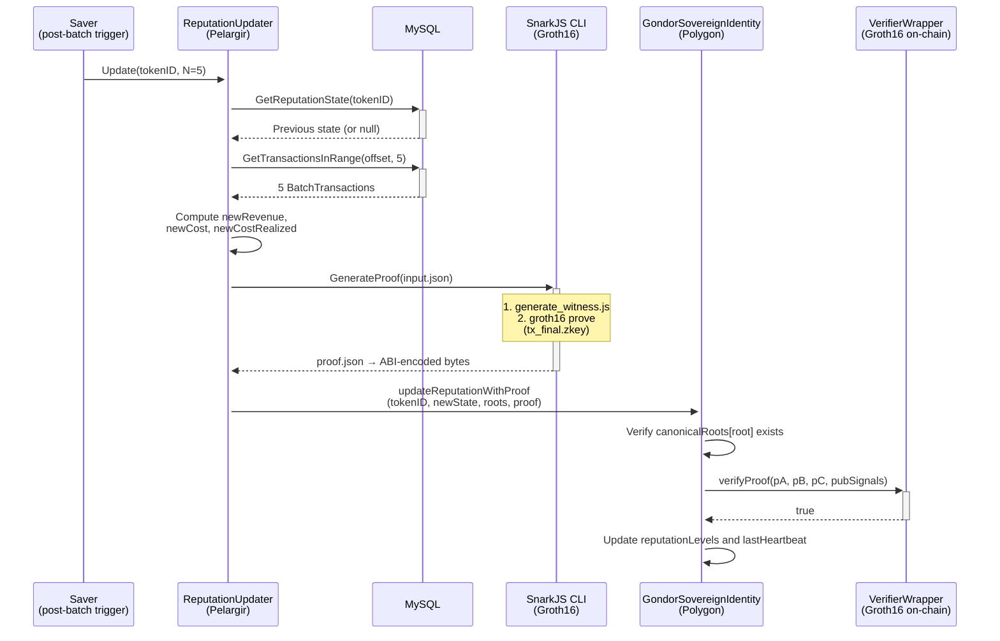

# ZK-SNARK Pipeline

Zero-Knowledge proof generation and on-chain verification pipeline for the Gondor Ecosystem's `BatchTxVerifier` circuit.

---

## Overview

The ZK pipeline transforms private transaction data into a public cryptographic proof that the blockchain can verify, without ever exposing the underlying trade details.

---

## Circuit: `BatchTxVerifier(N=5, depth=10)`

The circuit is parameterized for batches of **5 transactions** over Merkle trees of **depth 10** (supporting up to 1024 leaves per batch, with zero-padding).

### Signals

| Type | Signals | Description |
|---|---|---|
| **Public** | `tokenId` | The investor's SBT identifier on Polygon |
| **Public** | `oldTotalRevenue`, `oldTotalCostInvested`, `oldTotalCostRealized` | Financial state before this batch |
| **Public** | `newTotalRevenue`, `newTotalCostInvested`, `newTotalCostRealized` | Financial state after this batch |
| **Public** | `root[5]` | Merkle roots of the 5 batches — already anchored on-chain |
| **Private** | `userID[5]`, `symbol[5]`, `units[5]`, `price[5]`, `amount[5]`, `costBasis[5]`, `txType[5]`, `time[5]` | Full transaction details — never leave the server |
| **Private** | EdDSA signatures for each transaction | Server-side cryptographic commitments |
| **Private** | `pathElements[5][10]`, `pathIndices[5][10]` | Merkle inclusion proofs for each transaction |

### Constraints Applied Per Transaction

1. **Signature verification**: Recomputes the Poseidon hash of the 8 transaction fields and verifies the EdDSA signature against the server's public key. This proves that private inputs were signed by the server at trade execution time — they cannot be invented.

2. **Merkle inclusion proof**: Recomputes the leaf (`Poseidon(sigPart₁, sigPart₂)`) and verifies it belongs to an already-anchored Merkle root. This proves the transaction existed in a batch that was committed to Polygon.

3. **Identity constraint**: `userID[i]` must equal the public `tokenId`. This prevents using another user's transactions.

4. **Arithmetic accumulation**: Amounts are accumulated by operation type. Buys increment invested cost; sells increment revenue and realized cost basis.

5. **Final equality**: The accumulated totals must exactly match the declared public signals. If the prover attempts to declare a different ROI, the circuit will not generate a valid proof.

---

## Fixed-Point Arithmetic

ZK-SNARK circuits operate over the BN254 scalar field prime — a 254-bit prime number. There is no native support for floating-point or signed integers. The following conventions are applied:

- **Floating-point → fixed-point**: All monetary values are scaled by 10⁶ before entering the circuit. `$150.55` becomes `150,550,000`.
- **Division → cross-multiplication**: ROI ratios are computed as cross-multiplications to avoid integer division precision loss.
- **Negative ROI → modular arithmetic**: A negative ROI of −50 is represented as `q − 50` where `q` is the BN254 prime. The Solidity contract interprets this as a signed 256-bit integer to recover the negative value.

---

## Proof Orchestration

---

## Cryptographic Artifacts

| Artifact | Size | Description |
|---|---|---|
| `pot17_final.ptau` | ~151 MB | Powers of Tau MPC ceremony (Phase 1, trusted setup) |
| `tx_final.zkey` | ~38.5 MB | Circuit-specific proving key (Phase 2, operator artifact) |
| `tx_verifier.wasm` | ~4.2 MB | WebAssembly binary for witness generation |
| `verification_key.json` | ~5 KB | Verification key (embedded in the Solidity Verifier contract) |
| Serialized proof (calldata) | ~805 bytes | Fixed size per Groth16/BN254 proof — 3 elliptic curve points |

The `ptau` and `zkey` artifacts are **operator-side only** and never exposed to users. The ~805 byte proof is the only artifact that travels on-chain.

---

## Performance Benchmarks

Measured on Intel Core i7-1165G7 @ 2.80 GHz (CPU only, no GPU acceleration), 92 samples:

| Phase | Mean | Std Dev | Min | Max |
|---|---|---|---|---|
| Witness generation | 921 ms | ±489 ms | 304 ms | 2,670 ms |
| Groth16 proof generation | 13,596 ms | ±6,341 ms | 5,118 ms | 31,800 ms |
| **Total off-chain prover** | **14,586 ms** | **±6,531 ms** | **5,445 ms** | **32,840 ms** |

> Proof generation is fully asynchronous — it does not block trade execution. For a long-term investor completing a batch of 5 trades over several days, a ~15 second background computation is operationally negligible.
