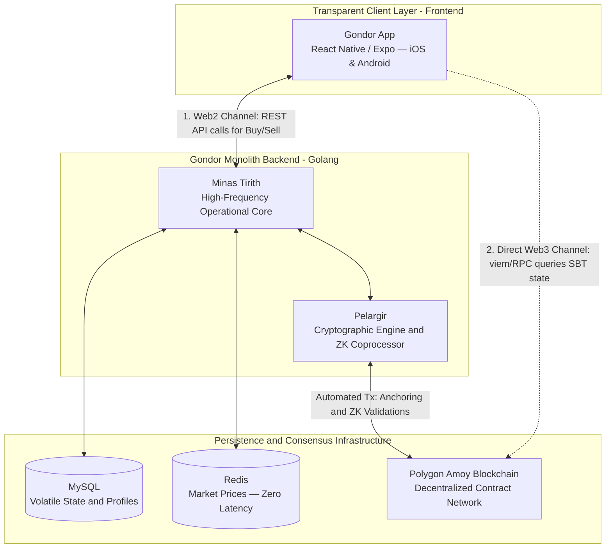

# Frontend — Mobile App and Audit Portal

> Repository: [`gondor-app`](https://github.com/MrCharlesSG/gondor-app)

The frontend layer closes the trust loop of the Gondor Ecosystem by giving investors and auditors intuitive interfaces to operate and verify — without introducing new centralization points that would undermine the cryptographic guarantees built in Phases 1–3.

---

## Design Principle: Dual-Channel Architecture

The fundamental innovation in the frontend is the **separation of channels** by trust level:

| Channel | Technology | Data | Trust Model |
|---|---|---|---|
| **Web2 (operational)** | REST API → Minas Tirith | Portfolio balance, trade history, real-time prices | Trusts the backend |
| **Web3 (verification)** | `viem` → Polygon Amoy RPC | Reputation level, SBT state, Heartbeat date | Trustless — reads directly from immutable blockchain |

The backend **cannot** influence the reputation data shown to the user, because the app bypasses it entirely for that information.

---

## Gondor App (Mobile)

**Technology**: React Native + Expo (cross-platform iOS/Android)

### Web2 Channel — Trading Operations

The app provides a familiar brokerage-like experience:

- **Asset search and market exploration** — Real-time price display (served from Redis via Minas Tirith REST API).
- **Trade execution** — Buy/sell orders via `POST /api/v0/portfolio/transactions/by-units` or `by-amount`.
- **Portfolio dashboard** — Consolidated view of holdings, valuation, and ROI from the backend.

All operational interactions go through standard HTTP REST calls to Minas Tirith. The sub-millisecond Redis cache ensures the trading experience feels instantaneous.

### Web3 Channel — Reputation Verification

When displaying the investor's on-chain reputation:

1. The app establishes a **direct RPC connection to Polygon Amoy** using the `viem` library.
2. It calls the `GondorSovereignIdentity` smart contract's view function (`getLevel(tokenId)`) directly.
3. The contract returns the reputation level, both metric values (`reputationLevels`, `reputationLevelsRealized`), and the `lastHeartbeat` timestamp.
4. This data is rendered in the UI without any intermediary.

The backend **is never consulted** for reputation data. Even if Minas Tirith is fully offline, the user can still verify their on-chain standing.

---

## Audit Portal (Web)

**Technology**: React

A read-only web application designed for **auditors and third parties** who want to inspect any investor's on-chain reputation without interacting with the Gondor backend at all.

The portal connects directly to Polygon Amoy via `viem` and displays:
- Current reputation levels (invested and realized ROI)
- Heartbeat status and last update timestamp
- Historical Merkle roots anchored by the investor's SBT

This enables a completely trustless audit of any investor's reputation — no API key, no authentication, no dependency on the Gondor backend.

---

## Validation

Phase 4 validation confirmed that:
- The mobile app successfully reads the SBT status and verified performance **directly from Polygon**, independent of the backend.
- The dual-channel architecture remains functional even when the backend is intentionally interrupted — the Web3 reputation view continues working.
- This confirms that the frontend delivers on the core promise: **the investor's reputation is portable and verifiable without depending on any platform**.
