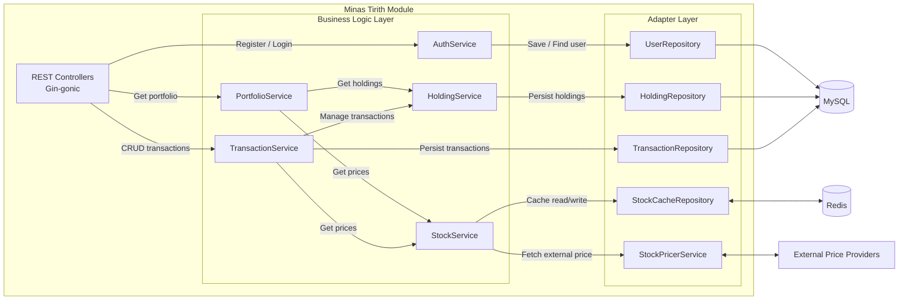
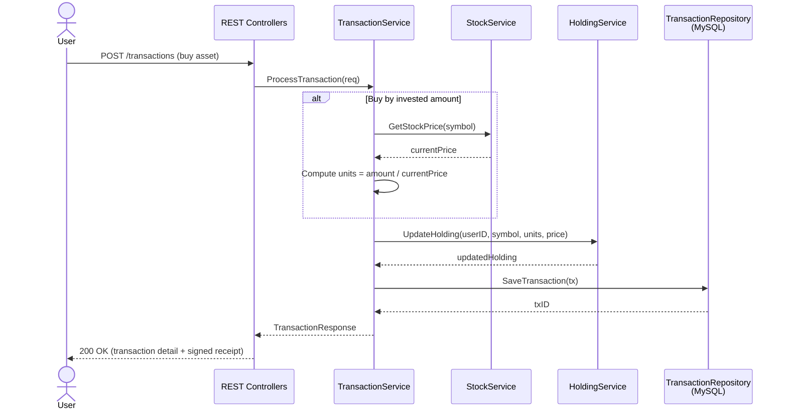
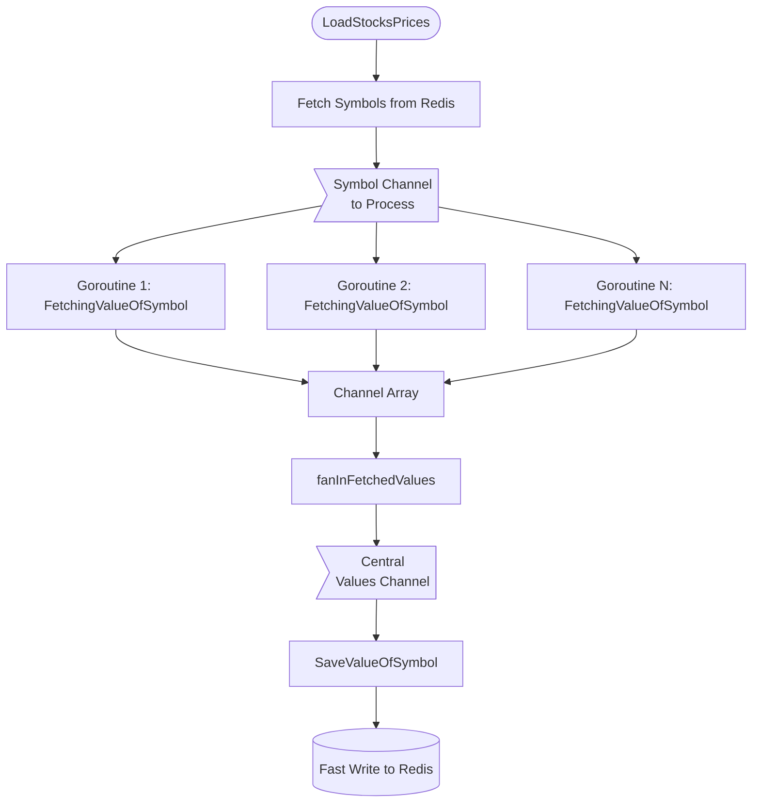
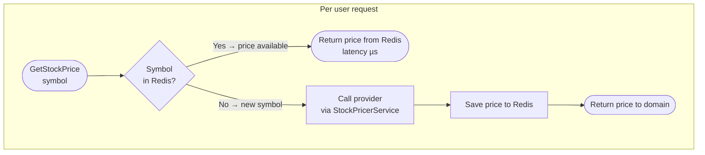

# Minas Tirith — Web2 Financial Engine

> Repository: [`gondor-backend`](https://github.com/MrCharlesSG/gondor-backend) — `minas-tirith/` directory

Minas Tirith is the high-speed **Web2 core** of the Gondor Ecosystem. It provides the financial infrastructure that every other component depends on: trade execution, portfolio management, and real-time stock pricing. It was designed to be bulletproof before introducing any blockchain complexity.

---

## Architecture: Hexagonal (Ports and Adapters)

Minas Tirith follows **Hexagonal Architecture** strictly, with three layers:

The domain layer **declares** its infrastructure needs as Go interfaces (ports). Adapters implement those interfaces. The business logic for ROI calculation, holding management, and trade processing can be tested in pure memory with zero infrastructure dependencies.

---

## Domain Services

| Service | Responsibility |
|---|---|
| `TransactionService` | Processes buy/sell orders (by units or by invested amount), updates holdings, persists transaction records, triggers Pelargir receipt signing |
| `HoldingService` | Aggregates position data per user/symbol — tracks units held, average buy price, total cost basis |
| `PortfolioService` | Consolidates all holdings into a valuation view — current total value, invested capital, global ROI metrics |
| `StockService` | Serves real-time stock prices (Redis-first); manages cache population and new symbol discovery |
| `AuthService` | User registration (bcrypt hashing), login, JWT issuance and verification (HMAC-SHA256) |

---

## Trade Execution Flow

---

## Stock Price Engine: Fan-in / Fan-out Concurrency

The most performance-critical component is the stock price update engine. Empirical profiling showed that **fetching a price from an external provider takes ~190% longer** than any other operation (database read, Redis write). This makes it the bottleneck and the ideal candidate for parallelization.

**Fan-Out**: N goroutines (one per CPU core) consume symbols from a shared channel, fetch external prices in parallel, and deposit results into individual output channels.

**Fan-In**: A single `fanIn` function merges all individual channels into one central channel. A final worker reads from it and writes serialized price updates to Redis, avoiding write race conditions.

### Multi-Provider Rotation

The `StockPricerService` maintains a pool of API clients (Finnhub at 30 req/s, Alpaca at 3 req/s). The `selectClient` algorithm:
1. Clients are sorted by rate limit at initialization (highest first).
2. When a price is requested, the current client is selected. If it has hit its limit, rotate to the next.
3. If all clients are exhausted, sleep until the next second (with random jitter) and reset counters.

### Redis Cache Strategy

When a user makes any API call (portfolio view, trade execution), **no external HTTP call is made**. The price is pre-computed in Redis and served with microsecond latency.

### Fault Tolerance: Retry Fallback

A reusable retry mechanism wraps every external call with configurable max retries and two error classes:
- **Retriable errors** (network timeout, 5xx): retried up to the configured limit.
- **Abortable errors** (400, 403, invalid symbol): immediately abort without retries.

This same fallback is reused by Pelargir for blockchain RPC calls.

---

## Performance Metrics

| Operation | Relative Time |
|---|---|
| `FindSavedSymbol` (Redis read) | ~1x (baseline) |
| `GetStockPrice` (external HTTP) | **~2.9x** (bottleneck) |
| `SaveAll` (Redis write) | ~1x |

Fan-in/Fan-out parallelization reduces the total update cycle time by approximately N (number of CPU cores) for the bottleneck operation.

---

## API Reference

### Authentication Endpoints

| Method | Endpoint | Description |
|---|---|---|
| `POST` | `/api/v0/auth/register` | Register a new user. Body: `{"username": "user", "password": "pwd"}` |
| `POST` | `/api/v0/auth/login` | Login and receive a JWT token. Body: `{"username": "user", "password": "pwd"}` |

### Authenticated Endpoints

All require `Authorization: Bearer <JWT_TOKEN>` header.

| Method | Endpoint | Description |
|---|---|---|
| `GET` | `/api/v0/auth/user` | Retrieve user profile and on-chain SBT ID |
| `GET` | `/api/v0/portfolio` | Real-time portfolio valuation, net holdings, accumulated ROI |
| `GET` | `/api/v0/portfolio/transactions` | User transaction history |
| `POST` | `/api/v0/portfolio/transactions/by-units` | Execute trade by number of units. Body: `{"symbol": "AAPL", "units": 5.0, "operation": "purchase"}` |
| `POST` | `/api/v0/portfolio/transactions/by-amount` | Execute trade by total invested amount. Body: `{"symbol": "GOOG", "units": 1500.0, "operation": "purchase"}` |

Use `"operation": "sale"` for sell orders in both trade endpoints.

---

## Testing

- **Coverage**: >85% on service layer, 70%+ on API and persistence layers, 100% on testable infrastructure adapters.
- **Strategy**: Domain services tested in pure memory using `gomock`-generated mocks for all port interfaces. No Docker containers required for unit tests.
- **Golden files**: REST API responses validated against reference files for deterministic regression detection.

See [development/testing.md](../development/testing.md) for the full testing strategy.
