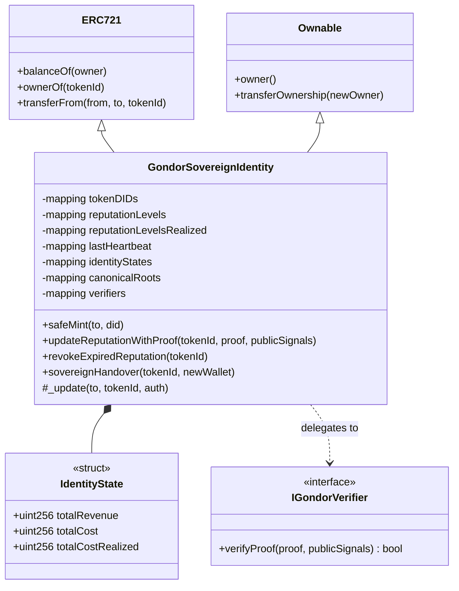
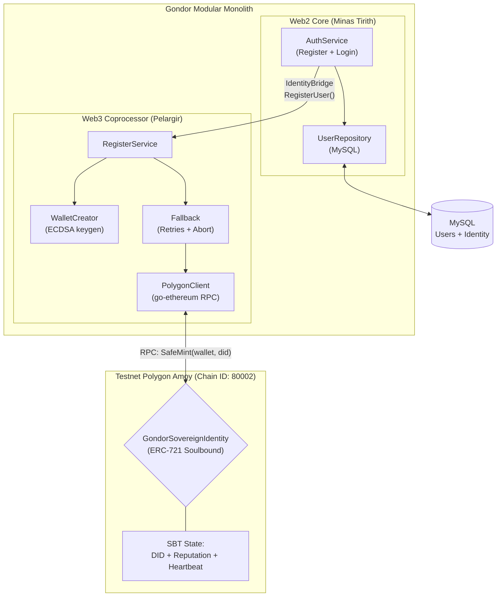
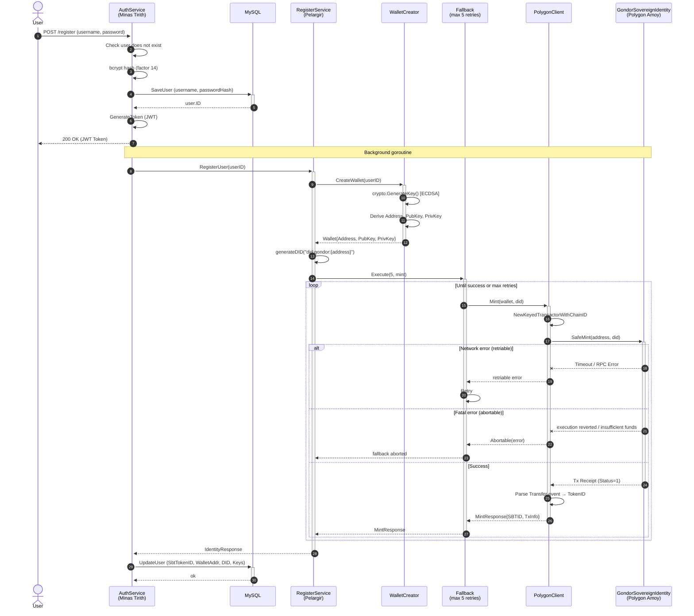

# Pelargir I — Sovereign Identity

> Repository: [`gondor-backend`](https://github.com/MrCharlesSG/gondor-backend) — `pelargir/` directory  
> Smart Contract: [`gondor-blockchain`](https://github.com/MrCharlesSG/gondor-blockchain)

Pelargir I is the first blockchain layer of the Gondor Ecosystem. Its single mission: give every investor a **sovereign, non-transferable identity** on the Polygon blockchain — automatically, without any Web3 friction.

The core insight is that reputation lock-in (an investor's track record being owned by a platform's database) can be solved by minting a cryptographic identity token that belongs to the investor's wallet, not to any server.

---

## Design Goals

- **Zero friction for the user**: Registration feels identical to any Web2 sign-up (username + password). No MetaMask, no seed phrases, no gas management.
- **Atomic consistency**: A user either exists in both MySQL and Polygon simultaneously, or in neither. Partial states are prevented through transaction management and retry logic.
- **Non-transferable identity**: The SBT cannot be bought or sold. Reputation must be earned, not purchased.
- **Future-ready**: The contract's data structures and verifier interface are designed from day one to receive ZK-SNARK proofs in Phase 2.

---

## Smart Contract: `GondorSovereignIdentity`

Deployed on **Polygon Amoy** (Chain ID 80002). Verified on PolygonScan (Amoy).

**Solidity 0.8.24** | **OpenZeppelin v5** | **ERC-721 Soulbound**



### Soulbound Property

The `_update()` override permanently blocks any transfer not initiated by the contract owner (Pelargir backend). `transferFrom` from any user wallet reverts with `"Gondor: SBT is non-transferable"`. This is permanent and irrevocable at the contract level.

### On-Chain Data Stored Per Token

| Field | Type | Description |
|---|---|---|
| `tokenDIDs` | `bytes32` | Decentralized Identifier in format `did:gondor:{walletAddress}` |
| `reputationLevels` | `uint256` | ROI over **total invested cost** (all buy operations) — initialized to 1 at mint |
| `reputationLevelsRealized` | `uint256` | ROI over **realized cost basis** (closed positions only) — initialized to 1 at mint |
| `lastHeartbeat` | `uint256` | Timestamp of last reputation update — used by the Heartbeat mechanism |
| `identityStates` | `IdentityState` | Accumulated `totalRevenue`, `totalCost`, `totalCostRealized` — updated via ZK proofs |
| `canonicalRoots` | `mapping(bytes32 => bool)` | Registry of anchored Merkle roots — used to validate ZK proof inputs |

### Dual Reputation Metric Design

The two reputation fields serve a specific anti-gaming purpose:

- `reputationLevels` = ROI computed over **all capital deployed** (every buy ever made).
- `reputationLevelsRealized` = ROI computed only over **closed positions** (trades where a sell has occurred).

An investor practicing *cherry-picking* (selling winners, holding losers) will show a high `reputationLevelsRealized` but a significantly lower `reputationLevels`. The observable divergence between the two metrics is itself a **public signal of selective transaction bias**.

### Heartbeat Mechanism

```
lastHeartbeat is updated on every updateReputationWithProof call.

isReputationExpired() → true if now > lastHeartbeat + 30 days

revokeExpiredReputation(tokenId):
  → resets reputationLevels to 0
  → resets reputationLevelsRealized to 0
  → emits ReputationExpired event
  → callable by anyone
```

This prevents an investor from freezing their reputation at a favorable state by simply stopping activity. After 30 days of inactivity, anyone can publicly revoke their reputation.

### Sovereign Handover

The `sovereignHandover(tokenId, newWallet)` function allows Pelargir (contract owner) to transfer SBT custody from the backend-managed wallet to a personal user wallet, materializing true self-sovereignty. The soulbound protection remains active — the new owner still cannot transfer the token autonomously.

---

## Pelargir Module: Go Implementation

The `RegisterService` orchestrates identity creation in four steps:

1. **Wallet creation** — Generates an ECDSA key pair with `go-ethereum/crypto`. Derives the Ethereum address from the public key.
2. **DID generation** — Constructs `did:gondor:{address}`.
3. **SBT minting** — Calls `PolygonClient` (generated from the contract ABI via `abigen`) to invoke `safeMint`. Wrapped in the retry fallback with up to 5 retries.
4. **User update** — On success, updates the MySQL user record with `SbtTokenID`, `WalletAddr`, `DID`, `PublicKey`, `PrivateKey`.

### Architecture



### Registration Sequence



### Error Classification in Blockchain Calls

| Error Type | Classification | Behavior |
|---|---|---|
| `execution reverted` | Abortable | Immediate abort, no retries |
| `insufficient funds` | Abortable | Immediate abort, no retries |
| `gas required exceeds allowance` | Abortable | Immediate abort, no retries |
| `nonce too high` | Abortable | Immediate abort, no retries |
| Network timeout | Retriable | Retried up to 5 times |
| RPC node unavailable | Retriable | Retried up to 5 times |

---

## Testing

- **Smart contract tests**: Hardhat + Chai + TypeScript fixtures. Each test deploys a fresh contract instance. Key tests verify that `transferFrom` reverts with `"Gondor: SBT is non-transferable"`, and that `sovereignHandover` preserves the soulbound property.
- **Verifier integration**: Tested with a `MockVerifier` contract — both the happy path and rejection cases validated.
- **Go service tests**: `AuthService` tests use `gomock`-generated mocks of the `IdentityBridge` interface. Cover both blockchain success and failure scenarios.
- **Fallback tests**: Exhaustive unit tests for retry behavior and abortable error handling.
