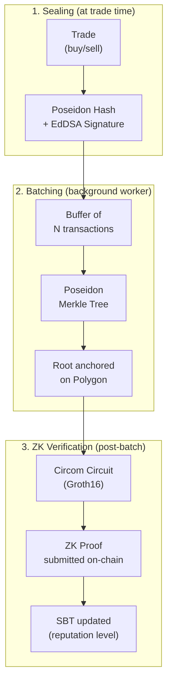
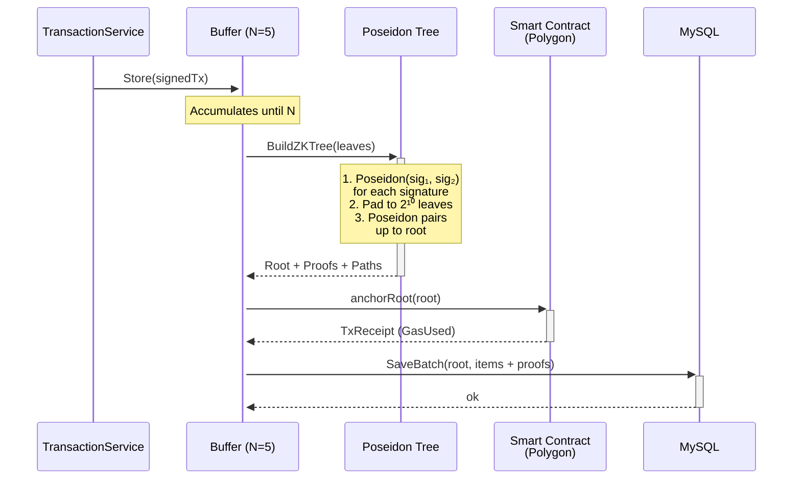

# Pelargir II — Cryptographic Certification

> Repository: [`gondor-backend`](https://github.com/MrCharlesSG/gondor-backend) — `pelargir/` directory  
> Smart Contract: [`gondor-blockchain`](https://github.com/MrCharlesSG/gondor-blockchain) — `circuit/` and `contracts/`

Pelargir II implements the *Verify-me* architecture — the cryptographic system that allows an investor to prove their financial reputation to the blockchain **without revealing any private transaction details**.

It solves two complementary attack vectors that an internal adversary (a platform operator with database access) could exploit:

1. **Retroactive data manipulation**: An admin with MySQL access could alter historical trades to artificially improve a user's performance. Nothing in Phase 1 or the Web2 engine prevents this.
2. **Public balance disclosure**: Proving verifiable performance on-chain would normally require exposing all transaction details to the smart contract — violating financial privacy and creating regulatory risk.

---

## The Three-Pillar Architecture (*Verify-me*)

---

## Pillar 1: Signed Receipts (EdDSA over Poseidon)

Every trade is sealed at execution time before it can be altered.

**Process:**

1. **Fixed-point conversion**: Floating-point values (`units`, `price`, `amount`) are scaled by 10⁶ to integers. The asset symbol is encoded as `big.Int` from ASCII bytes. Timestamp is recorded in Unix nanoseconds.

2. **Poseidon hash**: The 8 field elements (`tokenID`, `symbol`, `units`, `price`, `amount`, `costBasis`, `txType`, `time`) are hashed with Poseidon — a SNARK-friendly hash function with significantly fewer arithmetic constraints than SHA-256 or Keccak.

3. **EdDSA signature**: The Poseidon hash is signed with the server's BabyJubJub private key via EdDSA. The resulting 64-byte compressed signature is the **deterministic receipt** — an irrevocable cryptographic commitment to the exact content of the trade at the moment of execution.

The signed receipt is:
- Returned **synchronously** to the user with the HTTP trade response.
- Stored in the `TransactionBatcher` buffer for Merkle processing.
- Persisted in MySQL (`transaction` table) as a hex hash that any user can independently verify.

**Why EdDSA + Poseidon instead of ECDSA + SHA-256?** Both are natively supported as in-circuit components in Circom. Using the same primitives at receipt-signing time and in the ZK circuit eliminates the need for adapter circuits, dramatically reducing the constraint count.

---

## Pillar 2: Merkle Batching and On-Chain Anchoring

Anchoring each transaction individually would cost prohibitive gas. Pelargir batches N transactions into a single cryptographic fingerprint.

**Leaf construction**: Each signature (64 bytes) is split into two 32-byte halves. Each half is reduced modulo the BN254 scalar field prime. The two halves are combined: `leaf = Poseidon(part₁, part₂)`.

**Tree construction**: Leaves are zero-padded to 2¹⁰ = 1024 positions (depth 10). Each level is built by combining pairs: `node = Poseidon(left, right)`, until a single 32-byte root is reached. Depth 10 supports up to 1024 transactions per batch — ample headroom for future scaling without recompiling the circuit.

**Merkle proofs**: For each real leaf, its inclusion proof is stored in MySQL: the sibling hashes at each tree level and the path direction (0 = left, 1 = right). These are essential inputs for the ZK circuit.

**Integrity guarantee**: If any administrator alters a single transaction in MySQL, the signature hash changes, the leaf hash changes, and the reconstructed root will not match the one anchored months earlier on Polygon. Fraud becomes mathematically detectable by anyone.

**On-chain anchoring**: The root is sent to `GondorSovereignIdentity` via `anchorRoot(bytes32)`. The contract registers it in `canonicalRoots` and emits a `RootAnchored` event. Gas cost: ~47,680 units (~$0.00064 on Polygon mainnet).

---

## Pillar 3: ZK-SNARK Proofs

The `BatchTxVerifier(N=5, depth=10)` circuit — compiled with **Circom 2.1.6**, proven with **SnarkJS (Groth16)**, verified on-chain by a **Solidity verifier** generated by SnarkJS.

For full circuit details, signal definitions, constraint logic, and performance benchmarks, see [ZK-SNARK Pipeline](../architecture/diagrams/zk-pipeline.md).

**Summary of what the circuit proves:**
- Each transaction was signed by the server at trade execution time (EdDSA signature verification in-circuit).
- Each transaction belongs to a Merkle batch that was anchored on-chain (Merkle inclusion proof in-circuit).
- The accumulated ROI figures declared as public signals are arithmetically consistent with the private transaction data.
- All transactions belong to the same investor (`userID[i] === tokenId`).

The private inputs (individual trade details) are processed entirely off-chain and never appear on the blockchain.

---

## Heartbeat Mechanism

The Heartbeat is a two-level defense against reputation gaming through inactivity:

### Passive Heartbeat (On-Chain)

The smart contract's `revokeExpiredReputation` function can be called by **anyone** if an investor has not updated their reputation in more than **30 days**. This resets both `reputationLevels` and `reputationLevelsRealized` to 0 and emits a `ReputationExpired` event.

An investor who stops trading to freeze their reputation at a profitable moment will have it publicly revoked. The 30-day interval is configurable by the contract owner.

### Active Heartbeat (Off-Chain)

The `HeartbeatCron` background worker in Pelargir monitors user inactivity. If a user has pending transactions that haven't formed a complete batch (because they trade infrequently), the cron **force-completes the batch** by injecting dummy placeholder transactions.

This ensures that pending real transactions — which may include unfavorable trades — are included in the next ZK proof cycle. An investor cannot strategically delay submitting losing trades by simply not trading enough to trigger batch completion.

---

## Gas Cost Analysis

Measured on local Anvil node (deterministic EVM — identical gas cost to Polygon mainnet):

| Operation | Mean Gas | Mean Latency | Estimated Mainnet Cost* |
|---|---|---|---|
| `safeMint` — SBT Creation | 213,721 | 17 ms | $0.00288 |
| `anchorRoot` — Merkle Anchoring | 47,680 | 108 ms | $0.00064 |
| `updateReputationWithProof` — ZK Verification | 363,294 | 158 ms | ~$0.00490 |
| **Complete lifecycle** | **~624,695** | **~283 ms** | **~$0.0085** |

*Assuming 30 Gwei gas price and POL = $0.45*

The higher gas cost of `updateReputationWithProof` vs Sismo (Hydra-S1) or Worldcoin (Semaphore) is a direct consequence of **richer semantic content**: Gondor's circuit validates 5 transactions with 8 fields each, 5 EdDSA signatures, 5 Merkle proofs, and 3 derived ROI aggregates — substantially more than a single membership bit (Sismo) or binary signal (Semaphore).

---

## Testing

- **Unit tests**: `fakePolygonClient` mock validates receipt generation and batching logic independently.
- **Merkle tree tests**: Isolated unit tests for the Poseidon tree construction and proof generation.
- **End-to-end tests with Testcontainers**: Spin up MySQL + Anvil blockchain node in Docker. Simulate a complete user lifecycle (register, trade, anchor, generate ZK proof, verify on-chain). Test scenarios include:
  - ROI = −50% (negative ROI with modular arithmetic in circuit)
  - ROI = +99%
  - Interleaved transactions between multiple users (cross-user identity constraint validation)

See [development/testing.md](../development/testing.md) for the full testing strategy.
